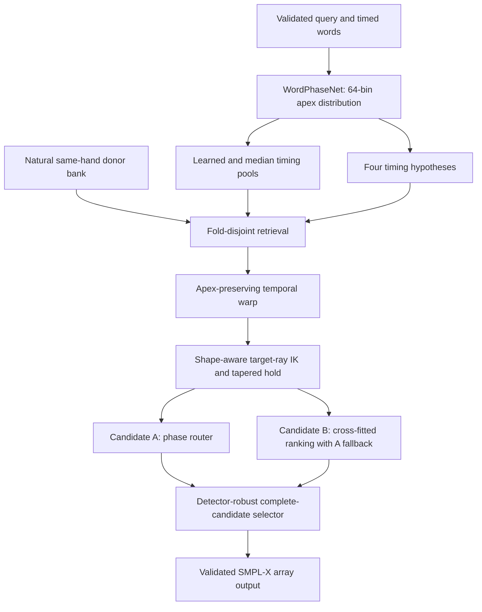

# Cleaned package architecture

`frozen/` is immutable historical evidence. `src/repointer/` provides explicit stage
interfaces, configuration and synthetic fixtures for maintainable development. The
cleaned implementation is not certified as numerically equivalent to historical runs.
In particular, synthetic kinematics is a test double, not SMPL-X or an official scorer.

The diagram describes stage responsibilities. It does not claim that a synthetic
smoke run uses released models or reproduces paper metrics. No residual/diffusion
generator is part of these interfaces.

## Module boundaries

| Module | Responsibility and contract |
|---|---|
| `contracts.py` | Validate `Motion`, `Query`, `Donor` and `Candidate` boundaries; make frame count, hand, target coordinates and shapes explicit |
| `config.py` | Load user paths relative to the configuration file, with explicit environment-variable expansion; separate external private assets from run outputs |
| `assets.py` | Separate external-asset configuration and path-free availability; require private research assets to remain outside source |
| `artifacts.py` | Read-only M1 coverage/donor/integrity audit with optional motion hashes/schemas; no model loading or archived-code execution |
| `replay.py` | Explicit historical-stage execution in a separate research interpreter and fresh private output root; verify frozen source hashes and stop on failed acceptance |
| `timing.py` | Timed-word feature extraction, ratio/frame conversion, distributional apex timing, optional PyTorch WordPhaseNet training/inference |
| `retrieval.py` | Natural same-hand donor filtering, fold/group exclusions, geometric and timing descriptors, deterministic nearest-neighbor ordering |
| `rotations.py` | Rotation conversions and interpolation used by resampling and IK |
| `warping.py` | Piecewise apex-preserving time map and full-clip resampling |
| `kinematics.py` | Backend boundary: explicit `SyntheticKinematics` test double and optional `SMPLXKinematics` adapter requiring user-supplied models |
| `ik.py` | Target-ray correction using query shape and active arm; taper the optimized apex into donor motion; synthetic finite-difference and optional torch/body-model paths |
| `evaluation.py` | Transparent local geometric and motion-quality diagnostics; synthetic motion-only apex heuristic; no organizer score claims |
| `candidates.py` | Build median/learned pools and multi-hypothesis donor pools using the shared realization backend |
| `ranking.py` | Training-only timing medians, conservative phase routing, four hypotheses, weighted ridge fitting and cross-fitted candidate ranking |
| `selector.py` | Detector-robust spatial utility and hard guards; return a complete A or B candidate unchanged |
| `challenge.py` | Validate/materialize candidate outputs, preserve exact selected bytes, and enforce the motion output contract; official validator remains external |
| `fixtures.py` | Construct small generated queries, word intervals and donor motions without challenge data or third-party model assets |
| `pipeline.py` | Orchestrate the fixture workflow through the same stage boundaries; retain explicit provenance and synthetic status |
| `cli.py`, `__main__.py` | Public training/inference/smoke and audit entry points, validation errors and reproducible command configuration |

See [`GETTING_STARTED.md`](GETTING_STARTED.md) for the supported command syntax.
Modules should receive data/backend/model objects explicitly rather than discover
machine-specific assets or import executable source from a research run directory.

The supported CLI commands are `make-fixture`, `train`, `infer`, `smoke`,
`audit-source`, `validate-motion`, `assets-status`, `audit-m1` and `replay`.
The first four take the synthetic `--config`. JSON/TOML
configuration provides separate, non-nested fixture, checkpoint and output roots;
relative paths resolve against the configuration file, and `${VARIABLE}` references
must be set explicitly. Existing run directories are rejected rather than overwritten.
Learned WordPhaseNet weights must be written outside the source repository.

External JSON asset configuration is separate. `assets-status` reports directory
availability; `audit-m1` reads an explicitly configured historical run and compares
coverage, leakage, hashes and optional motion arrays. Reports omit private paths and
sample identifiers. The public M1 reference binds a known external archive without
bundling its data. This does not connect real assets to the synthetic inference CLI.

`replay` is a separate historical execution path, not a silent backend switch in
`train` or `infer`. It supports CPU P1A retraining alone or a pretrained
P2A/P2C1/P2C2 chain. It refuses to mix new timing weights with stale P1_FULL evidence.
All real outputs and raw logs stay outside source; see [Real Reproduction](REAL_REPRODUCTION.md).

The fixture CLI always uses `SyntheticKinematics` and synthetic motion-only detector
heuristics. Its timing backend is either an explicitly named `synthetic-prior`
domain/hand distribution or optional PyTorch `wordphase` training. The prior demonstrates
contracts and orchestration; it is not a learned transcript timing model. Optional
`SMPLXKinematics` and torch IK are low-level APIs. A licensed full-pipeline CLI and
historical detector/checkpoint integration remain future work.

## Data and trust boundaries

The public motion contract accepts finite axis-angle rotations `(T,165)` or `(T,55,3)`
and translations `(T,3)`. Pose array shape does not prove that body-model FK, shape
adaptation or physical plausibility is correct. Backend metadata must make synthetic
and licensed SMPL-X execution distinguishable.

Words carry start/end times in seconds. Frame indices are zero-based. Ratios divide
by `T - 1`; transcript duration uses `T / fps`. Training labels, holds and oracle peaks
belong in supervised/evaluation data, not the inference query. Raw audio is outside
WordPhaseNet's feature contract.

Donor retrieval, timing normalization, domain/hand medians and ridge standardization
must fit only the training side of an evaluation fold. Candidate rows for the same
query/group must stay in one fold. An OOF test should check these exclusions rather
than merely checking prediction array dimensions. Small fixture training demonstrates
execution and serialization; its predictions have no scientific performance meaning.

Fixture training creates fold-excluded timing models, cross-fitted router predictions
and cross-fitted ranker diagnostics, then fits full-data artifacts for inference. This
staged OOF procedure is not a fully nested end-to-end generalization estimate: upstream
models used to form another fold's features may have seen labels from the eventual
outer validation fold. The fixture experiment also fixes the ridge penalty and ranker
replacement threshold instead of replaying historical calibration. Report these values
as execution diagnostics only. Inference binds training configuration, manifest, donor
motion contents and saved model files through SHA-256 hashes.

Candidate A is the conservative learned/median route. Candidate B searches four
timing hypotheses with multiple donors and retains complete A as fallback. The final
selector returns one candidate intact. Submission materialization must preserve its
motion arrays or exact copied file bytes, with no hidden pose blending or reoptimization.

## Testing and scientific parity

Tests should cover validation failures and stage invariants: frame/ratio round trips,
apex correspondence, proper rotations, fold-safe retrieval, query-shape use, tapered
hold continuity, cross-fit isolation, candidate fallback, exact selector identity and
motion schema. The end-to-end smoke workflow uses only generated fixtures and must
state that fact in its output.

Tests of an optional real body-model backend require separately licensed assets.
An unavailable backend should fail with an actionable dependency/path error, never
silently fall back to the synthetic backend. A skipped optional test is not evidence
of verified SMPL-X behavior.

Historical numerical parity is a separate milestone. It requires exact source/artifact
bindings, checkpoint-feature compatibility, the historical padding/batching policy,
identical body-model assets and a controlled environment. Compare intermediate apex
predictions, donor IDs, warped poses, IK outputs, candidate identities and selected
files before interpreting metric differences. The missing artifacts are inventoried
in [`SOURCE_AUDIT.md`](SOURCE_AUDIT.md).
